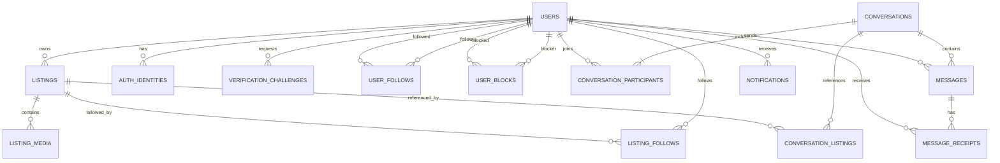

# Looply — Database Schema (Đồ án 1)

> **Trạng thái:** Bản thiết kế đề xuất (draft), **chưa phải schema đã triển khai**.  
> **Database:** PostgreSQL · **ORM:** Prisma 7  
> **Phạm vi:** Đồ án 1. Không bao gồm thanh toán, quản trị, xử lý vi phạm hoặc gợi ý AI.  
> **Vị trí đề xuất:** `docs/technical/database/DATABASE_SCHEMA.md`

## 1. Mục đích và nguyên tắc

Tài liệu mô tả mô hình dữ liệu phục vụ đăng ký/đăng nhập, hồ sơ, tin đăng, media, theo dõi, chặn người dùng, chat, thông báo và nhắc nhở của Looply. Đây là **đặc tả thiết kế để thảo luận và triển khai từng bước**, không khẳng định các bảng đã tồn tại trong source code.

**Nguồn nghiệp vụ ưu tiên:** `docs/requirements/DO_AN_1/LOOPLY_DOAN1_REQUIREMENTS.md`. Khi có xung đột, kiểm tra yêu cầu đã chốt với người dùng trước khi sửa schema. Các tên bảng, cột, enum, chỉ mục và cơ chế lưu trữ dưới đây là **đề xuất kỹ thuật**, trừ khi có ghi rõ “nghiệp vụ đã chốt”.

Nguyên tắc:
- Khóa chính ổn định, thời gian lưu dạng `timestamptz` (Prisma `DateTime @db.Timestamptz(3)`).
- Phân biệt **ẩn**, **không còn khả dụng**, **soft-delete** và xóa vật lý.
- Thực thi unique/FK/check/index ở database khi phù hợp; các quy tắc có điều kiện được kiểm tra thêm trong transaction/service.
- Không lưu OTP dạng plaintext, không lưu access token plaintext; không log dữ liệu nhạy cảm.
- Không thêm bảng chỉ vì một tính năng tương lai chưa thuộc Đồ án 1.
- `created_at`, `updated_at` được dùng ở các thực thể cần theo dõi; `updated_at` không tự chứng minh thời gian sửa nội dung tin đăng.

## 2. Tổng quan thực thể

| Nhóm | Bảng đề xuất | Chức năng |
|---|---|---|
| Tài khoản | `users` | Định danh người dùng, thông tin hồ sơ và vị trí |
| Xác thực | `auth_identities` | Phương thức đăng nhập nội bộ/Google, tách danh tính đăng nhập |
| Xác thực | `verification_challenges` | Theo dõi xác minh SMS/email, OTP đã hash, thời hạn và số lần thử |
| Tin đăng | `listings` | Nội dung và trạng thái tin đăng |
| Media | `listing_media` | Tối đa 5 ảnh và 1 video cho mỗi tin |
| Theo dõi | `user_follows` | Theo dõi người dùng |
| Theo dõi | `listing_follows` | Theo dõi tin đăng |
| Chặn | `user_blocks` | Quan hệ chặn người dùng |
| Chat | `conversations` | Một conversation duy nhất cho mỗi cặp user |
| Chat | `conversation_participants` | Trạng thái hiển thị/xóa riêng của từng thành viên |
| Chat | `conversation_listings` | Các tin đăng từng được nhắc tới trong conversation |
| Chat | `messages` | Tin nhắn và trạng thái gửi/nhận/đọc |
| Chat | `message_receipts` | Thời điểm delivered/read theo người nhận (có thể giản lược khi chỉ 1-1) |
| Thông báo | `notifications` | Thông báo in-app, đã đọc và xóa riêng người nhận |
| Nhắc nhở | **Chưa mặc định tạo bảng** | Có thể tính từ hồ sơ và session, tránh lưu dữ liệu không cần thiết |

**Lưu ý:** Danh sách là thiết kế đề xuất; không phải yêu cầu bắt buộc triển khai tất cả ngay từ đầu.

## 3. Sơ đồ quan hệ khái niệm

Sơ đồ biểu diễn quan hệ khái niệm; cardinality và ràng buộc “chính xác hai thành viên” của chat 1-1 phải được kiểm soát riêng.

## 4. Quy ước kỹ thuật đề xuất

- ID: `uuid` với `gen_random_uuid()` hoặc `@default(uuid())` tùy cách cấu hình Prisma; thống nhất trước migration đầu tiên.
- Naming: tên bảng/cột SQL dùng `snake_case`; Prisma có thể dùng `PascalCase`/`camelCase` với `@@map`/`@map`.
- Tiền: `numeric(14,2)` hoặc số nguyên VND; **chưa chốt** cách biểu diễn tiền. Không dùng `float`.
- Email: chuẩn hóa trước khi so sánh; unique không phân biệt chữ hoa/thường (có thể dùng `citext` hoặc functional unique index tùy migration).
- Số điện thoại: chuẩn hóa E.164; unique theo quy tắc tài khoản được chốt.
- Thời gian: lưu UTC, hiển thị theo múi giờ ứng dụng.
- Soft delete: dùng `deleted_at` hoặc trạng thái rõ ràng; không dùng hard delete cho lịch sử chat liên quan.
- Trường text tự do có giới hạn độ dài/validation ở backend; không dựa hoàn toàn vào frontend.

## 5. Chi tiết bảng

### 5.1 `users` — người dùng và hồ sơ

| Cột | Kiểu đề xuất | Ràng buộc/ý nghĩa |
|---|---|---|
| `id` | `uuid` | PK |
| `username` | `varchar(40)` | Unique; username đăng nhập, không dùng email thay thế |
| `display_name` | `varchar(100)` nullable | Tên hiển thị; **chưa chốt bắt buộc hay không** |
| `email` | `varchar(254)` nullable | Unique khi có giá trị; trạng thái xác minh tách riêng |
| `email_verified_at` | `timestamptz` nullable | Đã xác minh email |
| `phone` | `varchar(20)` nullable | Unique khi có giá trị; chuẩn hóa E.164 |
| `phone_verified_at` | `timestamptz` nullable | Đã xác minh điện thoại |
| `location_province_code` | `varchar(32)` | Vị trí tỉnh/thành phố bắt buộc theo nghiệp vụ |
| `location_label` | `varchar(120)` | Nhãn hiển thị vị trí; cân nhắc tránh sai lệch khi địa giới đổi |
| `avatar_media_key` | `text` nullable | Tham chiếu ảnh đại diện trong storage |
| `bio` | `text` nullable | Chỉ tạo nếu tính năng hồ sơ xác nhận cần |
| `created_at` | `timestamptz` | Ngày tạo |
| `updated_at` | `timestamptz` | Ngày cập nhật |
| `deleted_at` | `timestamptz` nullable | Dự phòng chính sách xóa tài khoản; **chưa chốt** |

**Đã chốt:** username tách biệt email; xác minh SMS trong luồng đăng ký nội bộ; vị trí tỉnh/thành phố bắt buộc; sửa vị trí hồ sơ không thay đổi tin đăng cũ.

**Cần quyết định:** Google signup có bắt buộc nhập username/phone/location bổ sung không; có cho một tài khoản nhiều phương thức xác thực không; chính sách unique của email/phone sau soft-delete.

### 5.2 `auth_identities` — phương thức xác thực

| Cột | Kiểu đề xuất | Ràng buộc/ý nghĩa |
|---|---|---|
| `id` | `uuid` | PK |
| `user_id` | `uuid` | FK → `users.id` |
| `provider` | enum | `LOCAL`, `GOOGLE` (đề xuất) |
| `provider_subject` | `varchar(255)` nullable | Google `sub`; unique cùng provider |
| `password_hash` | `text` nullable | Chỉ dành cho phương thức LOCAL; Argon2 |
| `created_at` | `timestamptz` | Ngày tạo |
| `updated_at` | `timestamptz` | Ngày cập nhật |

**Đã chốt:** Google login tách khỏi đăng nhập username/password; email Google không tự động trở thành tài khoản mật khẩu nội bộ. Đăng nhập bằng SMS OTP có thể gắn với user qua `phone`, **không bắt buộc** tạo identity `PHONE` riêng.

**Ràng buộc đề xuất:** `UNIQUE(provider, provider_subject)` cho Google; `UNIQUE(user_id, provider)` nếu mỗi user chỉ có một identity mỗi loại. Không tự liên kết tài khoản dựa trên email trùng nhau.

### 5.3 `verification_challenges` — xác minh OTP

| Cột | Kiểu đề xuất | Ràng buộc/ý nghĩa |
|---|---|---|
| `id` | `uuid` | PK |
| `user_id` | `uuid` nullable | FK → `users.id`; null khi đăng ký chưa có user |
| `purpose` | enum | `REGISTER_PHONE`, `LOGIN_PHONE`, `CHANGE_PHONE`, `CHANGE_EMAIL` (đề xuất) |
| `channel` | enum | `SMS`, `EMAIL` |
| `destination` | `varchar(254)` | Phone/email đã chuẩn hóa |
| `code_hash` | `text` | Không lưu OTP plaintext |
| `expires_at` | `timestamptz` | Hạn dùng |
| `attempt_count` | `integer` | Số lần thử |
| `consumed_at` | `timestamptz` nullable | Đã sử dụng |
| `created_at` | `timestamptz` | Ngày tạo |

**Chưa chốt:** thời hạn OTP, độ dài, số lần thử, resend cooldown, số OTP active, SMS/email provider và chính sách dọn bản ghi. Cần giới hạn tốc độ tại API và xử lý đồng thời để tránh dùng OTP nhiều lần.

### 5.4 `listings` — tin đăng

| Cột | Kiểu đề xuất | Ràng buộc/ý nghĩa |
|---|---|---|
| `id` | `uuid` | PK |
| `owner_id` | `uuid` | FK → `users.id`, bắt buộc |
| `title` | `varchar(200)` | Tiêu đề, phục vụ search |
| `description` | `text` | Mô tả; không dùng làm trường search theo nghiệp vụ |
| `transaction_type` | enum | `SALE`, `RENT`, `EXCHANGE` |
| `price_amount` | `numeric(14,2)` nullable | Giá; bắt buộc/nullable theo loại giao dịch **chưa chốt** |
| `rent_unit` | enum nullable | `DAY`, `MONTH`; chỉ dùng khi `RENT` |
| `location_province_code` | `varchar(32)` | Vị trí tin đăng bắt buộc, snapshot độc lập hồ sơ |
| `location_label` | `varchar(120)` | Tên địa phương hiển thị |
| `status` | enum | `VISIBLE`, `HIDDEN`, `UNAVAILABLE`, `DELETED` |
| `created_at` | `timestamptz` | Ngày đăng |
| `updated_at` | `timestamptz` | Ngày cập nhật |
| `deleted_at` | `timestamptz` nullable | Soft-delete, đồng bộ với status nếu dùng cả hai |

**Đã chốt:** 3 loại giao dịch; thuê theo ngày/tháng; vị trí tin độc lập vị trí hồ sơ; 4 trạng thái; lịch sử chat vẫn tồn tại khi tin không còn hiển thị; người sở hữu mới được sửa/xóa/ẩn.

**Quan trọng:** Đã có chat liên quan tin đăng **không đồng nghĩa cấm sửa**. Khi sửa, cần cảnh báo/xác nhận; sau khi cập nhật thành công, thông báo tới user có conversation liên quan. Quy tắc khóa/chuyển `transaction_type` sau tương tác phải được xác minh với requirements khi triển khai.

**Chỉ mục đề xuất:** `(status, created_at DESC, id DESC)`, `(owner_id, created_at DESC)`, `(transaction_type, status)`, `(location_province_code, status)`. Search title tiếng Việt cần đánh giá `pg_trgm`/unaccent/full-text và hiệu năng thực tế trước khi chọn; không search description.

### 5.5 `listing_media` — ảnh và video tin đăng

| Cột | Kiểu đề xuất | Ràng buộc/ý nghĩa |
|---|---|---|
| `id` | `uuid` | PK |
| `listing_id` | `uuid` | FK → `listings.id` |
| `media_type` | enum | `IMAGE`, `VIDEO` |
| `storage_key` | `text` | Đường dẫn/key tương đối trong storage |
| `mime_type` | `varchar(100)` | MIME được server xác minh |
| `size_bytes` | `bigint` | Dung lượng |
| `width` / `height` | `integer` nullable | Kích thước nếu có |
| `duration_seconds` | `integer` nullable | Video; giới hạn chính xác chưa chốt |
| `sort_order` | `smallint` | Thứ tự hiển thị |
| `created_at` | `timestamptz` | Ngày tạo |

**Đã chốt:** mỗi tin tối đa **5 ảnh và 1 video**, video upload trực tiếp, có preview, replace/reorder/delete. Lưu ý giới hạn đếm theo `listing_id` và `media_type` cần được bảo vệ trong transaction (hoặc trigger/constraint thích hợp) để tránh race condition. `UNIQUE(listing_id, sort_order)` chỉ phù hợp nếu thứ tự chung cho cả ảnh/video được thống nhất.

### 5.6 `user_follows` — theo dõi người dùng

| Cột | Kiểu đề xuất | Ràng buộc/ý nghĩa |
|---|---|---|
| `follower_id` | `uuid` | FK → users |
| `followed_id` | `uuid` | FK → users |
| `created_at` | `timestamptz` | Thời điểm theo dõi |

**Khóa đề xuất:** PK `(follower_id, followed_id)`; CHECK `follower_id <> followed_id`. Hủy follow cần xác nhận ở UX; không tạo notification follow/unfollow trong Đồ án 1.

### 5.7 `listing_follows` — theo dõi tin đăng

| Cột | Kiểu đề xuất | Ràng buộc/ý nghĩa |
|---|---|---|
| `user_id` | `uuid` | FK → users |
| `listing_id` | `uuid` | FK → listings |
| `created_at` | `timestamptz` | Thời điểm theo dõi |

**Khóa đề xuất:** PK `(user_id, listing_id)`. Theo dõi tin **không tính là tương tác chat**, không làm hạn chế quyền sửa tin. Người chỉ follow tin không nhận notification sửa tin nếu không có conversation liên quan.

### 5.8 `user_blocks` — chặn người dùng

| Cột | Kiểu đề xuất | Ràng buộc/ý nghĩa |
|---|---|---|
| `blocker_id` | `uuid` | FK → users |
| `blocked_id` | `uuid` | FK → users |
| `created_at` | `timestamptz` | Thời điểm chặn |

**Khóa đề xuất:** PK `(blocker_id, blocked_id)`; CHECK hai user khác nhau. **Đã chốt:** chặn ngăn chat, không tự thay đổi follow hay khả năng nhìn thấy tin đăng; có danh sách chặn/unblock. **Chưa chốt:** chi tiết hiệu lực một chiều/hai chiều đối với việc khởi tạo/gửi tin; không tự suy diễn.

### 5.9 `conversations` — hội thoại 1-1

| Cột | Kiểu đề xuất | Ràng buộc/ý nghĩa |
|---|---|---|
| `id` | `uuid` | PK |
| `participant_low_id` | `uuid` | FK → users; ID nhỏ hơn trong cặp |
| `participant_high_id` | `uuid` | FK → users; ID lớn hơn trong cặp |
| `created_at` | `timestamptz` | Ngày tạo |
| `last_message_at` | `timestamptz` nullable | Tối ưu sắp xếp inbox |

**Ràng buộc quan trọng:** `UNIQUE(participant_low_id, participant_high_id)` và CHECK hai ID khác nhau. Cặp ID được chuẩn hóa nhất quán để **một cặp user chỉ có một conversation**, kể cả chat tự do hoặc từ nhiều tin khác nhau. Tạo conversation phải chống race condition bằng unique constraint + transaction/upsert.

**Thiết kế thay thế:** dùng `conversation_participants` làm nguồn sự thật và bảng khóa cặp riêng; không triển khai cả hai phương án độc lập mà thiếu quy tắc nhất quán.

### 5.10 `conversation_participants` — trạng thái riêng mỗi người

| Cột | Kiểu đề xuất | Ràng buộc/ý nghĩa |
|---|---|---|
| `conversation_id` | `uuid` | FK → conversations |
| `user_id` | `uuid` | FK → users |
| `hidden_at` | `timestamptz` nullable | Người dùng ẩn/xóa conversation ở phía mình |
| `last_read_at` | `timestamptz` nullable | Phục vụ unread count, nếu chọn cơ chế timestamp |
| `created_at` | `timestamptz` | Thời điểm tham gia |

**Khóa đề xuất:** PK `(conversation_id, user_id)`. Phải bảo đảm chỉ hai user đúng với cặp trong `conversations` được tham gia. Khi có tin nhắn mới từ phía bên kia, conversation đã ẩn phải hiện lại cho người nhận theo nghiệp vụ. Có thể dùng `hidden_at` + `last_message_at` hoặc reset `hidden_at` trong transaction; **chọn một cơ chế duy nhất**.

### 5.11 `conversation_listings` — tin được nhắc trong chat

| Cột | Kiểu đề xuất | Ràng buộc/ý nghĩa |
|---|---|---|
| `conversation_id` | `uuid` | FK → conversations |
| `listing_id` | `uuid` | FK → listings |
| `first_referenced_at` | `timestamptz` | Thời điểm liên kết đầu tiên |

**Khóa đề xuất:** PK `(conversation_id, listing_id)`. Quan hệ nhiều-nhiều giúp một conversation chứa nhiều tin; một tin có thể xuất hiện trong nhiều conversations. Nếu cần hiển thị thẻ sản phẩm đúng tại vị trí tin nhắn, có thể bổ sung `messages.listing_id` nullable hoặc message type `LISTING_REFERENCE` khi triển khai UI — **chưa quyết định schema cuối**.

**Không xóa cascade quan hệ lịch sử** khi listing soft-delete; dùng trạng thái tin và giữ tham chiếu.

### 5.12 `messages` — tin nhắn

| Cột | Kiểu đề xuất | Ràng buộc/ý nghĩa |
|---|---|---|
| `id` | `uuid` | PK |
| `conversation_id` | `uuid` | FK → conversations |
| `sender_id` | `uuid` | FK → users; phải thuộc conversation |
| `message_type` | enum | `TEXT` (mở rộng nếu thật sự cần) |
| `body` | `text` | Nội dung tin nhắn |
| `listing_id` | `uuid` nullable | Nếu cần gắn thẻ tin đăng với message |
| `created_at` | `timestamptz` | Đã gửi/lưu trên server |

**Đã chốt:** chat realtime; sent = server đã lưu; delivered = client người nhận đã nhận; read = người nhận đã mở conversation; không thu hồi/xóa tin đã gửi. `UNIQUE(conversation_id, id)` là thừa nếu `id` đã PK. Index `(conversation_id, created_at DESC, id DESC)` phục vụ tải lịch sử.

### 5.13 `message_receipts` — xác nhận nhận/đọc

| Cột | Kiểu đề xuất | Ràng buộc/ý nghĩa |
|---|---|---|
| `message_id` | `uuid` | FK → messages |
| `recipient_id` | `uuid` | FK → users; phải là người còn lại trong conversation |
| `delivered_at` | `timestamptz` nullable | Client người nhận xác nhận đã nhận |
| `read_at` | `timestamptz` nullable | Người nhận đã đọc |

**Khóa đề xuất:** PK `(message_id, recipient_id)`; với chat 1-1 chỉ có tối đa một receipt cho mỗi message. `read_at` không được có trước `delivered_at` theo quy tắc xử lý đã chọn. Nếu dùng `conversation_participants.last_read_at` để suy ra trạng thái đọc, cân nhắc bỏ bảng này **chỉ khi** vẫn đáp ứng trạng thái từng tin và delivered.

### 5.14 `notifications` — thông báo in-app

| Cột | Kiểu đề xuất | Ràng buộc/ý nghĩa |
|---|---|---|
| `id` | `uuid` | PK |
| `recipient_id` | `uuid` | FK → users |
| `type` | enum | Ví dụ `LISTING_UPDATED`, `SYSTEM` — xác định khi triển khai |
| `actor_id` | `uuid` nullable | FK → users nếu có tác nhân |
| `listing_id` | `uuid` nullable | FK → listings để điều hướng |
| `conversation_id` | `uuid` nullable | FK → conversations để điều hướng |
| `payload` | `jsonb` nullable | Chỉ metadata cần thiết, không lưu bí mật |
| `read_at` | `timestamptz` nullable | Đánh dấu đã đọc |
| `deleted_at` | `timestamptz` nullable | Xóa riêng ở notification center |
| `created_at` | `timestamptz` | Ngày tạo |

**Đã chốt:** in-app notifications, đánh dấu từng cái/tất cả đã đọc, xóa, không tự hết hạn; toast tự tắt nhưng bản ghi còn. Chat notification chỉ cần **biểu tượng và số chưa đọc**, không preview nội dung. Có thể tính chat unread từ `messages`/read cursor, **không nhất thiết tạo một notification record cho mỗi message**; tránh double count.

**Chỉ mục đề xuất:** `(recipient_id, deleted_at, created_at DESC)` và partial index cho unread nếu cần. Thông báo sửa tin gửi đến các user có conversation liên quan, không gửi chỉ vì follow tin.

### 5.15 Reminder — chưa cần bảng mặc định

**Đã chốt:** nhắc bổ sung thông tin tùy chọn có ích, không chặn trải nghiệm; bỏ qua trong phiên hiện tại và kiểm tra lại phiên sau. Vì dữ liệu thiếu có thể suy ra từ `users`, lựa chọn đơn giản là kiểm tra khi đăng nhập/tạo phiên và lưu dismiss trong trạng thái phiên client/server phù hợp. **Chỉ tạo** `reminder_dismissals` hoặc `user_sessions` nếu yêu cầu triển khai thực tế cần lưu trạng thái bền vững, đồng bộ đa thiết bị hoặc định nghĩa session phía server.

## 6. Quy tắc toàn vẹn quan trọng

| Quy tắc | Cách bảo vệ đề xuất |
|---|---|
| Username/email/phone không trùng theo chính sách | Unique index + chuẩn hóa input |
| Không tự liên kết Google và LOCAL | Kiểm tra provider subject; không join chỉ bằng email |
| OTP dùng một lần | Hash, expiry, attempts, consume nguyên tử |
| Một cặp user chỉ có một conversation | Unique normalized pair + transaction |
| Người gửi tin thuộc conversation | Authorization server; cân nhắc ràng buộc bổ sung |
| Listing owner mới được sửa | Authorization server |
| Tin ẩn/unavailable/deleted không tạo chat mới | Kiểm tra status trong transaction khởi tạo chat |
| Chat cũ vẫn tồn tại khi tin soft-delete | Không hard-delete listing / quan hệ lịch sử |
| 5 ảnh + 1 video tối đa | Transaction/locking hoặc constraint/trigger phù hợp |
| Follow/block không tự tác động lẫn nhau | Service không cascade nghiệp vụ ngoài yêu cầu |
| Sửa listing đã có chat cần xác nhận | UX + API contract rõ ràng; transaction cập nhật và phát sự kiện |
| Thông báo chỉ tới đúng người | Query conversation-listing + distinct recipient, không notify followers thuần |

## 7. Giao dịch và tính nhất quán

1. **Đăng ký:** xác minh OTP hợp lệ, tạo user và identity, đánh dấu OTP consumed nguyên tử. Không gửi SMS/email trong DB transaction dài.
2. **Tạo conversation:** chuẩn hóa cặp user; kiểm tra listing khả dụng khi bắt đầu từ tin; upsert conversation và thêm liên kết listing trong transaction. Nếu conversation đã có, reuse.
3. **Gửi tin:** xác minh membership và block policy; ghi message; cập nhật last_message_at; phục hồi conversation ẩn cho người nhận theo quy tắc; gửi Socket.IO event **sau khi commit**.
4. **Sửa listing:** xác thực owner; kiểm tra yêu cầu xác nhận; cập nhật listing; xác định recipients từ conversation; lưu notification/event một cách nhất quán. Nếu cần độ tin cậy sự kiện cao, cân nhắc transactional outbox **khi có nhu cầu**, không mặc định thêm ngay.
5. **Upload media:** không thể atomic hoàn toàn giữa filesystem và PostgreSQL; cần quy trình staging/cleanup khi thất bại để tránh file rác hoặc record trỏ tới file thiếu.

## 8. Chính sách xóa và FK

- Không dùng `ON DELETE CASCADE` một cách tùy tiện từ `users`/`listings` tới `messages`, `conversations`, `conversation_listings` hoặc `notifications` vì phải giữ lịch sử theo nghiệp vụ.
- `listings.status = DELETED` là soft-delete; cân nhắc `deleted_at` phục vụ audit nhưng tránh hai nguồn trạng thái mâu thuẫn.
- Xóa conversation ở phía người dùng là thay đổi `conversation_participants`, không xóa message chung.
- Xóa notification chỉ ẩn đối với người nhận; không làm mất sự kiện gốc.
- Chính sách xóa tài khoản, retention OTP và dọn media chưa chốt; không tự quyết định cascade trước khi triển khai.

## 9. Tối ưu truy vấn dự kiến

- Feed mới nhất: index theo `status`, `created_at`, `id`; pagination bằng cursor ổn định nếu được chốt.
- Feed người theo dõi: join `user_follows` → `listings` theo owner và thời gian; tránh N+1 queries.
- Search title: đánh giá thực nghiệm cách xử lý tiếng Việt, không mặc định search description.
- Chat inbox: index participant/user, last_message_at, message conversation/time.
- Unread count: ưu tiên query/index phù hợp; chỉ cache/denormalize khi có bằng chứng cần thiết.
- Không tối ưu sớm bằng bảng thống kê đếm nếu query hiện tại đủ tốt.

## 10. Mapping sang Prisma 7

Khi triển khai `schema.prisma`:
- Kiểm tra phiên bản Prisma thực tế và cách cấu hình datasource/adapter hiện hành.
- Định nghĩa enum, model, relation, `@@unique`, `@@index`, `@map`/`@@map` tương ứng.
- Với CHECK, partial index, extension `citext`/`pg_trgm` hoặc trigger chưa được Prisma schema hỗ trợ trực tiếp, quản lý bằng SQL migration có kiểm soát.
- Không sửa migration đã áp dụng ở môi trường có dữ liệu; tạo migration mới.
- Kiểm tra `prisma validate`, migration diff/status, generated client và integration tests trước khi xác nhận hoàn thành.
- Tài liệu này **không thay thế** `schema.prisma`, migration SQL hay kết quả kiểm tra database thực tế.

## 11. Thứ tự triển khai database đề xuất

| Giai đoạn | Phạm vi | Điều kiện xác nhận |
|---|---|---|
| 1 | `users`, `auth_identities`, `verification_challenges` | Chốt luồng đăng ký nội bộ/Google và OTP |
| 2 | `listings`, `listing_media` | Chốt trường bắt buộc, giá, upload và trạng thái |
| 3 | `user_follows`, `listing_follows`, `user_blocks` | Chốt block direction/policy |
| 4 | `conversations`, `conversation_participants`, `conversation_listings`, `messages`, receipts | Chốt read/delivered và thẻ listing trong chat |
| 5 | `notifications` | Chốt event types, điều hướng, unread semantics |
| 6 | Reminder persistence nếu cần | Chốt định nghĩa session và dữ liệu thực sự cần lưu |

Đây là **thứ tự khuyến nghị**, không phải tiến độ đã thực hiện. Sau mỗi bước, cập nhật `DEVELOPMENT_PROGRESS.md` dựa trên migration, code và test thực tế.

## 12. Các quyết định còn mở — không tự chốt

1. Google signup: các trường bắt buộc và quy trình hoàn thiện hồ sơ.
2. Account linking và giới hạn một user có bao nhiêu identity.
3. Chính sách username, email/phone uniqueness và soft-delete tài khoản.
4. OTP: TTL, độ dài, số lần thử, resend, provider.
5. Giá bán/thuê/trao đổi: nullability, đơn vị tiền, precision và validation.
6. Danh sách trường bắt buộc của listing và chi tiết chuyển trạng thái.
7. Thời lượng video tối đa, dung lượng, MIME/codec và xử lý video.
8. Cơ chế search title tiếng Việt và feed N/random/cursor.
9. Chính sách block một chiều/hai chiều khi gửi/nhận tin.
10. Chat: cách gắn listing card vào message, receipts hay read cursor, client acknowledgments.
11. Notification: loại sự kiện cụ thể và cơ chế không đếm trùng chat unread.
12. Reminder: định nghĩa session và có cần persistence không.
13. Chính sách xóa tài khoản, retention, cleanup và audit.

## 13. Checklist trước khi tạo migration

- [ ] Đối chiếu từng bảng với phần requirements liên quan.
- [ ] Xác minh schema/migrations hiện có, không giả định database trống.
- [ ] Phân biệt yêu cầu đã chốt và lựa chọn kỹ thuật còn mở.
- [ ] Thống nhất tên cột, enum, ID strategy, unique/check/index.
- [ ] Xác định FK delete behavior, transaction boundaries, race conditions.
- [ ] Kiểm tra quyền truy cập, dữ liệu nhạy cảm và retention.
- [ ] Viết migration nhỏ theo module; không tạo toàn bộ bảng chỉ vì tài liệu này có liệt kê.
- [ ] Chạy validate/test phù hợp và cập nhật tài liệu + tiến độ theo kết quả thực tế.

---

**Ghi chú cho AI Agent:** Không dùng tài liệu này làm lệnh tự động sinh tất cả model. Chỉ triển khai phần phục vụ tác vụ hiện tại, sau khi kiểm tra code, migration và yêu cầu đã chốt. Khi có khác biệt giữa đề xuất ở đây và nghiệp vụ chính thức, phải báo rõ trước khi thay đổi.
